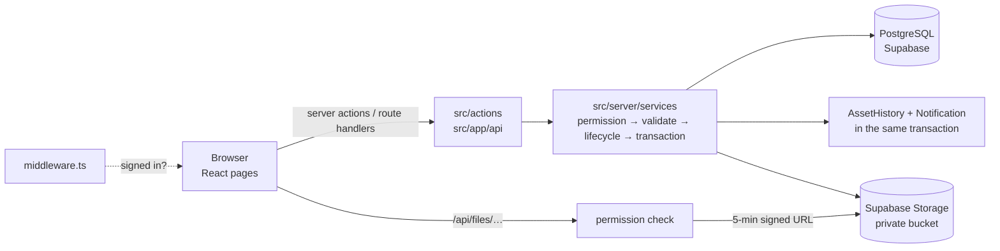

# AssetTrace

Company asset lifecycle management for Adz4needz: know **what asset exists, where it is, who is responsible
for it, what condition it is in, and what happened to it** — from registration to retirement.

Built as a full-stack Next.js application (internship assignment, Full-Stack Development Intern).

> Screenshots: `docs/screenshots/` _(add before submission: dashboard, asset detail, handover, reports)._

---

## Features

**Lifecycle** — register → assign → employee signs the handover → transfer → issue → maintenance → return →
mandatory inspection → retire, with a status state machine that blocks invalid moves
(e.g. a returned asset can't be reassigned until it's inspected; an assigned asset can't be retired).

| Area | What you can do |
|---|---|
| Assets | Register (auto ID `AST-LAP-0001`), edit, photo, category icons, QR label (PNG + printable), search and filter by ID, serial, category, brand, employee, department, location, status, condition, warranty state, purchase year; reserve / release, mark lost / found |
| Assignment & handover | Assign with location, dates, condition, accessories, remarks; employee confirms with a **drawn signature** or reports a problem (disputed handover); reminders; overdue list |
| Transfers | Employee or manager requests → manager approves/rejects → new assignment → completes when the new holder signs |
| Issues & requests | Employee reports issues (category, severity, photo) and requests replacement / return / new asset; manager inbox and **issue board** (reported → under review → maintenance → resolved → closed) |
| Maintenance | Records with provider, cost, parts, notes, warranty flag, expected/actual dates; completion restores the asset and resolves the issue |
| Returns & inspection | Receive (condition, missing accessories, damage, up to 3 photos) → inspection (screen, keyboard, battery, charger, function…) → result sets Available / Under maintenance / Damaged / Retire |
| Retirement | Date, reason, final condition, disposal method, authorised by; record becomes read-only and stays in history and reports |
| History | Every change writes an append-only timeline entry (event, date/time, who); employee history shows only their own holding periods; **Activity** page lists all transactions |
| Dashboards | Role dashboards with KPI cards, location status bars, "needs your action", charts (status, category, department, location, maintenance cost, warranty expiry, monthly transactions) |
| Reports & export | 8 reports with filters and preview; **CSV and Excel (.xlsx)** export, scoped to the user |
| Notifications | In-app bell + page: assigned, handover signed/disputed, transfer requested/completed, return requested, maintenance completed, warranty expiring (idempotent daily check), issue/request updates |
| Admin | Users & roles, departments (with managers), locations, categories, vendors, employees, system settings (org name, asset ID prefix, warranty window) |
| Security | Role-based access in three layers, department-scoped managers, private file storage with signed URLs, forced password change for temporary passwords, no hard deletes |

## Roles

| | Employee | Manager | Admin |
|---|---|---|---|
| Own assets, sign handover, report issues, requests | ✅ | ✅ | ✅ |
| Register / edit / assign / transfer / return / inspect / retire | – | ✅ own departments | ✅ |
| Maintenance, employee requests, reports & export | – | ✅ own departments | ✅ all |
| Employees, locations | – | ✅ | ✅ |
| Users, roles, departments, categories, vendors, settings | – | – | ✅ |

## Tech stack (all free tiers)

Next.js 15 (App Router) + TypeScript · PostgreSQL on Supabase · Prisma 6 · Auth.js v5 (credentials, bcrypt) ·
Zod · Tailwind CSS 4 + shadcn/ui (Base UI) · Recharts · `qrcode` / `html5-qrcode` · Supabase Storage (private
bucket) · papaparse + SheetJS (xlsx) · sonner · Playwright (end-to-end tests). No paid APIs, no AI features.

## Architecture



- **One app, no separate backend:** pages, server actions and route handlers run in the same Next.js process.
- **Every write goes through `src/server/services/*`:** `requireUser()` → `can()` + department scope → Zod →
  `assertTransition()` (`src/server/lifecycle.ts`) → `prisma.$transaction` writing the record, an
  `AssetHistory` row and `Notification` rows. Pages never write to the database directly.
- **Reads are scoped** with `assetScope()` / `managedAssetScope()` / `requestScope()` (`src/server/permissions.ts`).
- **Concurrency:** the asset row is locked (`SELECT … FOR UPDATE`) during lifecycle changes, and a partial
  unique index guarantees one active assignment per asset.
- **Database API locked down:** row-level security is enabled on every table with no policies, so
  Supabase's public REST API can't read anything; the app connects as the table owner via Prisma.

### Data model (summary)

`User` (login, role) ↔ `Employee` (code, department, location) · `Department` (managers) · `Location` ·
`AssetCategory` (code → asset ID) · `Vendor` · **`Asset`** (status, condition, holder, QR token, photo) ·
`Assignment` (+ handover status, signature) · `AssetTransfer` · `AssetIssue` · `MaintenanceRecord` ·
`AssetReturn` → `AssetInspection` · `AssetRetirement` · **`AssetHistory`** (append-only timeline) ·
`EmployeeRequest` · `Notification` · `Sequence` (running numbers) · `Setting`.
Full schema: [`prisma/schema.prisma`](prisma/schema.prisma). Design notes: [`docs/ARCHITECTURE.md`](docs/ARCHITECTURE.md).

## Getting started

Requirements: Node.js 20+ and a Supabase project (free).

```bash
npm install
cp .env.example .env          # fill in the values below
npx prisma migrate deploy     # create tables, partial index, RLS
npx prisma db seed            # demo data (WIPES all tables first)
npm run dev                   # http://localhost:3000
```

| Variable | Where it comes from |
|---|---|
| `DATABASE_URL` | Supabase → Connect. Locally the session pooler (port 5432) is fastest; on Vercel use the transaction pooler (port 6543, `?pgbouncer=true`) |
| `DIRECT_URL` | Session pooler / direct connection, used for migrations |
| `AUTH_SECRET` | `npx auth secret` |
| `AUTH_TRUST_HOST` | `true` outside Vercel |
| `NEXT_PUBLIC_SUPABASE_URL`, `SUPABASE_SERVICE_ROLE_KEY` | Supabase → Project settings → API (service key is server-only) |
| `SUPABASE_BUCKET` | A **private** bucket, default `asset-files` |
| `NEXT_PUBLIC_APP_URL` | Base URL used in QR codes when the request host is unknown |
| `CRON_SECRET` | Protects `/api/cron/warranty` (optional daily job) |

### Demo accounts

| Role | Email | Password |
|---|---|---|
| Admin | admin@assettrace.dev | Admin@123 |
| Manager (IT, Engineering, Design) | manager@assettrace.dev | Manager@123 |
| Employee | employee@assettrace.dev | Employee@123 |

Other seeded users (e.g. `priya@adz4needz.in`) use `Password@123`.

## Commands

| Command | |
|---|---|
| `npm run dev` | Development server |
| `npm run build` / `npm start` | Production build / server (`NEXT_DIST_DIR=.next-build` builds beside a running dev server) |
| `npm run lint` | ESLint |
| `npx prisma studio` | Browse the database |
| `npx playwright test` | End-to-end tests against a running app (uses your installed Chrome; they change data — reseed afterwards) |

## Deploying (Vercel, free)

1. Import the GitHub repo in Vercel. `vercel.json` pins functions to **Tokyo (`hnd1`)**, next to the database,
   and schedules the daily warranty check.
2. Add the environment variables above (`DATABASE_URL` = transaction pooler with `?pgbouncer=true`,
   `NEXT_PUBLIC_APP_URL` = the Vercel URL).
3. Deploy (the build runs `prisma generate`), then once: `npx prisma migrate deploy` and `npx prisma db seed`
   against the production database.

## Assignment coverage (Final Requirement list)

| # | Requirement | Where |
|---|---|---|
| 1 | Login | `/login` (Auth.js credentials, bcrypt) |
| 2 | Manage employees | `/employees`, `/admin/users` |
| 3 | Register assets | `/assets/new` |
| 4 | Categorize assets | `/admin/categories`, category on every asset |
| 5 | Assign assets | `/assignments/new` |
| 6 | Confirm handovers | `/my-assets/handover/[id]` (signature or dispute) |
| 7 | Transfer assets | Asset page / My assets → `/transfers` |
| 8 | Report issues | `/report-issue`, `/issues` |
| 9 | Manage maintenance | `/maintenance` |
| 10 | Return assets | `/my-requests` (return), `/returns` |
| 11 | Inspect returned assets | `/returns/[id]/inspect`, `/inspections` |
| 12 | Retire assets | `/assets/[id]/retire` |
| 13 | View asset history | Asset page → History, `/my-history`, `/activity` |
| 14 | Handle employee requests | `/requests` |
| 15 | Search and filter records | Every list page |
| 16 | View dashboards | `/dashboard`, `/home` |
| 17 | Generate reports | `/reports` |
| 18 | Export data | CSV / Excel from `/reports` |
| 19 | Receive notifications | Bell + `/notifications` |
| 20 | Secure role-based access | Middleware, page guards, service-layer `can()` + scope |

## Project structure

```
src/
  app/(auth)/login            sign-in page
  app/(app)/(staff)/…         manager & admin pages (dashboard, assets, assignments, …, admin/*)
  app/(app)/(employee)/…      employee self-service (home, my-assets, report-issue, my-requests, my-history)
  app/(app)/…                 shared (notifications, profile, scan)
  app/api/                    auth, files (signed URLs), export, cron
  actions/                    thin server actions → services
  server/services/            all business logic and writes
  server/queries/             scoped read models (lists, dashboard, reports)
  server/{permissions,lifecycle,history,notify,sequence,storage}.ts
  components/                 shell, forms, lists, charts, badges
prisma/                       schema, migrations, seed
e2e/                          Playwright tests, one file per phase
docs/                         architecture, plan, prototype, enhancements backlog
```

Planned next steps are in [`docs/ENHANCEMENTS.md`](docs/ENHANCEMENTS.md) (bulk import, QR audits, depreciation, bulk labels).
